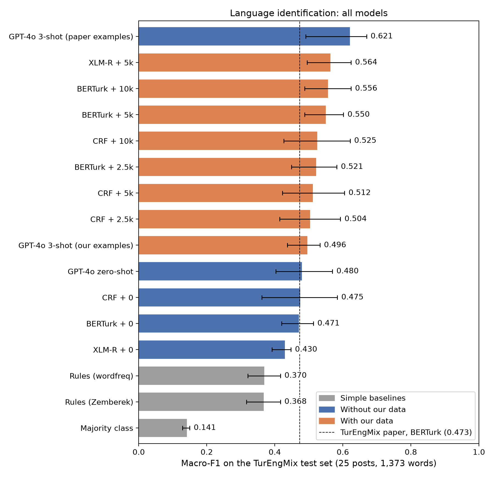
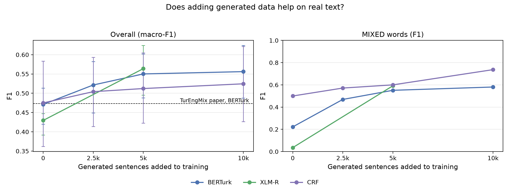
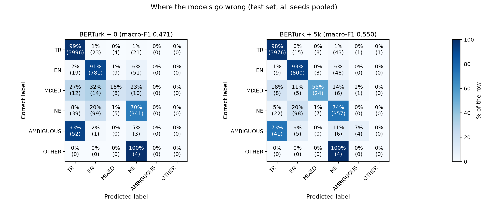

# TR-EN-CodeSwitch-LID

**Does generated training data help language identification on real Turkish–English
code-mixed text?**

For every word in a post, a model predicts one of six labels from the
[TurEngMix](https://github.com/kemnguyenle/TurEngMix) scheme:

| Label | Meaning | Example |
|---|---|---|
| `TR` | Turkish | `bugün`, `internet` |
| `EN` | English | `deadline`, `online` |
| `MIXED` | English stem + Turkish ending | `linki`, `meeting'e`, `downloadla` |
| `NE` | part of a name | `netflix'te`, `galatasaray` |
| `AMBIGUOUS` | both languages, context doesn't decide | `platform`, `hey` |
| `OTHER` | a third language | `arigato` |

TurEngMix's training split is small (254 sentences) and has only **159 `MIXED` words**, the
hardest label. We wrote **10,004 labelled code-mixed sentences**, added 0 / 2,500 / 5,000 /
10,000 of them to training, and measured every model on the **real** TurEngMix test set.

## Main results

All models are scored the same way, on the 25 TurEngMix **test** posts (1,373 words), with
TurEngMix's own scoring code. Macro-F1 is the mean F1 over the six labels. The data size for each
model was chosen on the **validation** split only.

| Model | Generated data | Test macro-F1 [95% CI] | `MIXED` F1 |
|---|--:|--:|--:|
| Majority class | – | 0.141 | 0.00 |
| Rules (wordfreq) | – | 0.370 | 0.17 |
| Rules (Zemberek) | – | 0.368 | 0.17 |
| CRF | 0 | 0.475 [0.36, 0.58] | 0.50 |
| CRF | **10,000** | 0.525 [0.43, 0.62] | 0.74 |
| BERTurk (4 seeds) | 0 | 0.471 [0.42, 0.51] | 0.22 |
| BERTurk (4 seeds) | **5,000** | **0.550** [0.49, 0.60] | 0.55 |
| XLM-R (4 seeds) | 0 | 0.430 [0.39, 0.45] | 0.04 |
| XLM-R (4 seeds) | **5,000** | **0.564** [0.50, 0.62] | 0.59 |
| GPT-4o, zero-shot | – | 0.480 [0.40, 0.57] | 0.36 |
| GPT-4o, 3 examples from the paper | – | 0.621 [0.49, 0.67] | 0.43 |
| GPT-4o, 3 examples from our data | – | 0.496 [0.44, 0.53] | 0.38 |

Full table with per-label F1 and all sizes: [`results/results_table.md`](results/results_table.md).







Figures are made by `python src/plot_figures.py`.

**Findings**

1. **Reproduction.** BERTurk on real data only scores 0.471; the TurEngMix paper reports 0.4734.
2. **Generated data helps both fine-tuned models.** BERTurk +0.079 (95% CI of the difference
   +0.04 to +0.13); XLM-R +0.134. `MIXED` F1 rises from 0.22 to 0.55 (BERTurk) and from 0.04 to
   0.59 (XLM-R). For BERTurk, every size (2,500 / 5,000 / 10,000) beats real data only, on
   validation and on test.
3. **GPT-4o.** With the paper's three examples it has the highest macro-F1, but the test set
   contains **one** `OTHER` word, and getting it right adds about +0.08 to a six-label mean. Without
   `OTHER`, the fine-tuned models with our data are ahead (XLM-R 0.677, BERTurk 0.660, GPT-4o
   0.645). On `MIXED`, GPT-4o (0.43) stays below them (0.55–0.59). Using our sentences as the
   prompt examples did **not** help GPT-4o (0.496).
4. **Human check of the generated labels.** Three native speakers labelled a blind mix of 202 real
   and 200 generated words. Their majority vote matches **our** labels more often (accuracy 83.5%,
   `MIXED` F1 0.97) than TurEngMix's own labels on the real words (74.3%, `MIXED` F1 0.81).
   Details: [`results/human_agreement.md`](results/human_agreement.md).
5. **What still fails.** English stems with a Turkish ending and no apostrophe (`linki`,
   `webin`, `folku`) remain the main error. Details:
   [`results/error_analysis.md`](results/error_analysis.md).

**Read with care**

- The test set is small: 11 `MIXED` words, 14 `AMBIGUOUS`, 1 `OTHER`. Rare labels make
  macro-F1 jumpy, which is why we report confidence intervals (2,000 bootstrap resamples of the
  25 test posts).
- The validation split is also small (25 posts), so the size choice between 5,000 and 10,000 is
  not clear-cut ([`results/ibrahim_size_choice.md`](results/ibrahim_size_choice.md)).
- The paper reports its LLM results on all 250 posts; we report everything on the test split
  only, so our GPT-4o numbers are not comparable with the paper's.
- The generated sentences were written by an AI model, not by real users. Their limitations are
  listed in [`data/generated/README.md`](data/generated/README.md).

## The generated dataset

`data/generated/generated.jsonl`: 10,004 sentences in Ekşi Sözlük style, one label per word,
built from the raw batches in `data/generated/raw/`. The first 2,500 / 5,000 / 10,000
sentences form the nested training sets of the size experiment. Every sentence passes automatic
checks (label format, real Turkish suffixes on `MIXED` words, no word that TurEngMix only has in
its validation or test splits). How it was made, statistics and limitations:
[`data/generated/README.md`](data/generated/README.md). Label rules:
[`report/annotation_guide.md`](report/annotation_guide.md).

## Repository

| Path | Contents |
|---|---|
| `data/` | TurEngMix benchmark and document splits (`benchmark.csv`, `splits/`), our generated data (`generated/`) |
| `src/lid_io.py` | Shared loading and prediction-file helpers |
| `src/build_generated.py`, `src/check_generated.py` | Build the generated dataset from the raw batches; quality checks |
| `src/baseline_rules.py`, `src/baseline_crf.py` | Rule baselines and CRF |
| `src/train_encoder.py` | BERTurk / XLM-R fine-tuning (paper settings) |
| `src/run_llm.py`, `prompts/` | GPT-4o baselines (from TurEngMix) |
| `src/make_annotation.py`, `src/agreement.py`, `annotation/` | Human annotation study |
| `src/score_all.py` | Scores every prediction file the same way → `results/results_table.*` |
| `results/` | Predictions, training logs, results table, reports, figures |
| `notebooks/error_analysis.ipynb` | Error analysis |
| `report/` | Label guide (`annotation_guide.md`) and presentation slides (`TR-EN-CodeSwitch-LID_presentation.pptx`) |
| `turengmix/` | Scoring and data code vendored from TurEngMix (MIT) |

## Reproduce

Python 3.12.

```bash
pip install -r requirements.txt

# generated data (already in the repo)
python src/build_generated.py
python src/check_generated.py data/generated/generated.jsonl

# models (each writes results/predictions/<run>_{validation,test}.csv)
python src/baseline_rules.py
python src/baseline_crf.py
python src/train_encoder.py --model dbmdz/bert-base-turkish-cased --name berturk --extra-n 5000 --seeds 1 2 3 4 --fp16
python src/run_llm.py --help              # GPT-4o; needs OPENAI_API_KEY in .env

# scores and human agreement
python src/score_all.py --reference berturk_gen0
python src/agreement.py
```

Fine-tuning settings follow the TurEngMix paper: learning rate 2e-5, weight decay 0.01, warm-up
6%, batch size 16, up to 10 epochs with early stopping (patience 3), best epoch on validation
macro-F1, seeds 1–4.

## Team

**The Avengers:** Shahem (lead; generated dataset, shared code, scoring), Ibrahim (BERTurk and XLM-R),
Mahmut (rules, CRF, error analysis), Tuğra (GPT-4o, agreement study), Seleni (figures,
licences). Ibrahim, Mahmut and Tuğra also did the native-speaker annotation. See
`contributions/CONTRIBUTIONS.md`.

## Licence and citation

Code: MIT (`LICENSE`). TurEngMix data and our generated data: CC BY-NC-SA 4.0
(`data/TURENGMIX_DATA_LICENSE`, `data/generated/LICENSE.md`). Please cite TurEngMix and the tools
listed in `CITATION.md`.
